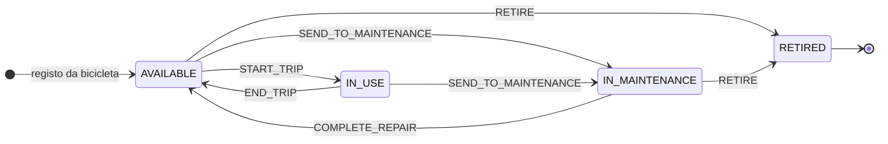

# Fleet Management Service · Máquina de estados do ciclo de vida

Serviço Spring Boot que gere o estado de cada bicicleta (RF06): que estados existem, que mudanças são
permitidas, quem as pode pedir, o histórico de cada mudança (RF07) e o aviso aos outros serviços pelo Kafka.

## Diagrama de estados



## Tabela de transições

Qualquer combinação que não esteja nesta tabela é recusada.

| De | Evento | Para | Quem pode pedir | Exemplo |
|---|---|---|---|---|
| AVAILABLE | `START_TRIP` | IN_USE | Rider, sistema | O rider lê o QR code e desbloqueia a bicicleta |
| IN_USE | `END_TRIP` | AVAILABLE | Rider, sistema | O rider estaciona num hub e termina a viagem |
| AVAILABLE | `SEND_TO_MAINTENANCE` | IN_MAINTENANCE | Sistema, operador, técnico | O módulo de ML deteta uma anomalia e abre um ticket |
| IN_USE | `SEND_TO_MAINTENANCE` | IN_MAINTENANCE | Sistema, operador | Alerta crítico (ex.: travões) durante a viagem |
| IN_MAINTENANCE | `COMPLETE_REPAIR` | AVAILABLE | Técnico | Reparação feita, a bicicleta volta à frota |
| AVAILABLE | `RETIRE` | RETIRED | Operador | Fim de vida |
| IN_MAINTENANCE | `RETIRE` | RETIRED | Operador, técnico | Dano sem reparação possível |

O papel "sistema" (`SYSTEM`) é usado pelos serviços internos, como o módulo de ML ou as regras de alerta.

**Regras importantes:**
- `RETIRED` é **final**: uma bicicleta retirada não volta à frota. O histórico fica guardado.
- Uma bicicleta **em uso não pode ser retirada** diretamente. Primeiro a viagem termina ou a bicicleta vai para manutenção.
- Uma bicicleta **em manutenção não pode iniciar uma viagem**.
- Uma bicicleta entra sempre na frota como `AVAILABLE`.
- Quando é aberto um ticket de manutenção, a bicicleta passa logo a `IN_MAINTENANCE`, sem esperar que um técnico o aceite. Assim sai de circulação o mais cedo possível. Esta foi a decisão tomada para resolver a dúvida que vinha do MS2.

## Porque se pede um *evento* e não um *estado*

O cliente não diz "põe esta bicicleta em `AVAILABLE`". Diz o que aconteceu, por exemplo `COMPLETE_REPAIR`.
Assim a regra fica toda num só sítio (`BikeLifecycleStateMachine`). Por exemplo, voltar a `AVAILABLE` por
`END_TRIP` só o rider pode pedir, e por `COMPLETE_REPAIR` só o técnico; com um simples "mudar estado" isto
não se distinguia.

## Como está organizado

```
src/main/java/pt/ua/kinetiq/fleet/lifecycle/
├── domain/       regra pura, sem Spring nem base de dados
│   ├── BikeState, LifecycleEvent, ActorRole
│   ├── Transition                       uma linha da tabela
│   └── BikeLifecycleStateMachine         a tabela e a validação
├── persistence/  entidades JPA (bikes, bike_state_transitions) e repositórios
├── service/      BikeLifecycleService: valida, grava estado + histórico e prepara o evento, numa transação
├── events/       BikeStateChangedEvent e envio para o Kafka depois do commit
└── api/          endpoints REST e tradução dos erros para HTTP
src/main/resources/db/migration/V1__bike_lifecycle.sql   tabelas (Flyway)
docs/bike-state-changed-schema.json                       contrato do evento Kafka
```

## Endpoints

| Método | Caminho | Para quê |
|---|---|---|
| `GET` | `/bikes/{bikeId}/state?role=RIDER` | Estado atual e eventos que esse papel pode pedir (para a interface mostrar só os botões válidos) |
| `POST` | `/bikes/{bikeId}/transitions` | Pede uma mudança de estado |
| `GET` | `/bikes/{bikeId}/transitions` | Histórico, do mais recente para o mais antigo |

Exemplo:

```bash
curl -X POST http://localhost:8081/bikes/MB-2026-001/transitions \
  -H 'Content-Type: application/json' \
  -d '{"event": "SEND_TO_MAINTENANCE", "actorRole": "SYSTEM", "actorId": "ml-module", "reason": "Battery draining 3x faster"}'
```

Respostas:

| Código | Quando |
|---|---|
| `200` | Transição feita. Devolve o novo estado e os próximos eventos permitidos. |
| `400` | Pedido mal formado (evento inexistente, campo em falta). |
| `403` | A transição existe mas esse papel não a pode pedir (ex.: um rider a retirar uma bicicleta). |
| `404` | A bicicleta não está registada. |
| `409` | A transição não existe a partir do estado atual (devolve `allowedEvents`), ou a bicicleta mudou de estado ao mesmo tempo por outro pedido. |

Por agora, `actorRole` e `actorId` vêm no corpo do pedido. Quando o Keycloak e a API Gateway estiverem
ligados, passam a ser lidos do token JWT.

## Evento no Kafka

Cada mudança de estado publica uma mensagem no tópico **`fleet.events.status`** (chave = `bikeId`, para as
mudanças da mesma bicicleta chegarem por ordem). O formato está em `docs/bike-state-changed-schema.json`.
O WebSocket Service consome-o para atualizar o mapa e as dashboards ao vivo.

A mensagem só é enviada **depois** de a base de dados confirmar a mudança. Limitação conhecida: se o Kafka
estiver em baixo nesse momento, o estado fica gravado mas a mensagem perde-se. A solução seguinte seria o
padrão *transactional outbox*.

## Correr e testar

Requisitos: Java 21 e Maven 3.9+.

```bash
mvn test                  # testes (não precisam de Docker, base de dados nem Kafka)
docker compose up -d      # na raiz do repositório: Postgres + Kafka
mvn spring-boot:run       # arranca em http://localhost:8081
```

Os testes cobrem:
- **Máquina de estados:** as 80 combinações possíveis (4 estados × 5 eventos × 4 papéis), comparadas com
  uma especificação escrita à parte. Também confirmam que `RETIRED` é final e que todos os estados são alcançáveis.
- **Serviço:** uma transição válida grava o estado, o histórico e o evento. Uma inválida ou sem permissão não altera nada.
- **API:** os códigos 200, 400, 403, 404 e 409.

## Integração no repositório

- O tópico `fleet.events.status` é criado pelo `kafka-init` do `docker-compose.yml` da raiz.
- O contrato do evento está também em `docs/schemas/bike-state-changed-schema.json`.
- A tabela `bikes` é criada aqui só com as colunas do ciclo de vida. O resto do modelo de dados (zonas,
  posições, alertas, tickets, viagens, event store) está em `V2__fleet_data_model.sql`, explicado em
  `docs/data-model.md`. Os endpoints de registo acrescentam as suas colunas numa migração `V3__...` e
  criam as bicicletas com `new Bike(bikeId, agora)`, que as põe em `AVAILABLE`.
- As 5 bicicletas de exemplo (`MB-2026-001` a `005`, as mesmas do simulador) estão no fim de
  `V1__bike_lifecycle.sql`. Apagar essas linhas quando o registo estiver ligado.
