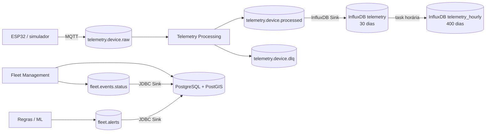
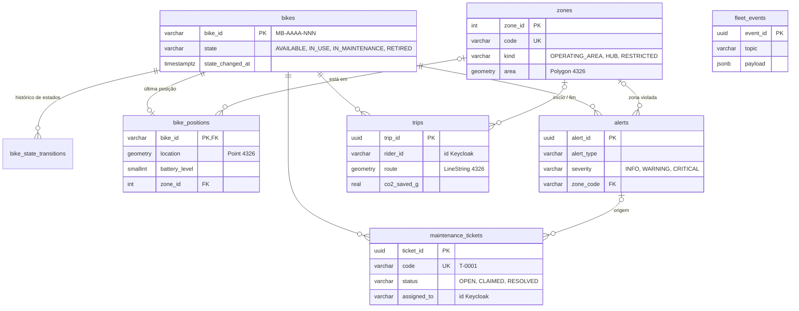

# Event store e modelos de dados

Onde fica cada dado do KinetiQ, com que forma e durante quanto tempo.

| Onde | O quê | Quem escreve | Retenção |
|---|---|---|---|
| **Kafka** (event store de curto prazo) | Todos os eventos: telemetria bruta e validada, alertas, mudanças de estado | MQTT Source, Telemetry Processing, Fleet Management | 7 dias (DLQ: 30 dias) |
| **InfluxDB** `telemetry` | Telemetria validada, ponto a ponto, por bicicleta | InfluxDB Sink (a partir de `telemetry.device.processed`) | 30 dias |
| **InfluxDB** `telemetry_hourly` | Médias por hora de cada bicicleta | Task do InfluxDB, de hora a hora | 400 dias |
| **PostgreSQL + PostGIS** | Estado atual da frota, zonas, alertas, tickets, viagens e cópia dos eventos de domínio | Fleet Management Service, JDBC Sink | Viagens: 90 dias depois do fim. Resto: enquanto a conta/bicicleta existir |

As retenções seguem o slide "What we collect and why" (GDPR). Nomes, emails e passwords ficam só no
Keycloak: as tabelas guardam apenas o id do utilizador (pseudónimo).



## 1. Kafka: o event store

Todos os tópicos são criados pelo `kafka-init` do `docker-compose.yml`, com 3 partições.

| Tópico | Conteúdo | Chave | Contrato | Retenção |
|---|---|---|---|---|
| `telemetry.device.raw` | Payload tal como chegou por MQTT | tópico MQTT | `telemetry-schema.json` | 7 dias |
| `telemetry.device.processed` | Telemetria validada | `bikeId` | `telemetry-schema.json` | 7 dias |
| `telemetry.device.dlq` | Mensagens rejeitadas pela validação | igual ao raw | — | 30 dias |
| `fleet.alerts` | Alertas das regras e do ML | `bikeId` | `alert-schema.json` | 7 dias |
| `fleet.events.status` | Mudanças de estado das bicicletas | `bikeId` | `bike-state-changed-schema.json` | 7 dias |

A chave `bikeId` garante que os eventos da mesma bicicleta ficam na mesma partição e chegam por ordem.
Os 7 dias chegam para reprocessar depois de uma falha (RNF18). O que tem de durar mais é copiado para o
InfluxDB ou para a tabela `fleet_events` do PostgreSQL.

## 2. InfluxDB: séries temporais

Configurado por `infra/influxdb/init/10-kinetiq-setup.sh`, no primeiro arranque.

**Measurement `bike_telemetry`** (bucket `telemetry`, 30 dias)

| Tipo | Nome | Origem no evento | Exemplo |
|---|---|---|---|
| tag | `bike_id` | `bikeId` | `MB-2026-001` |
| field (float) | `latitude` | `location.latitude` | `40.6405` |
| field (float) | `longitude` | `location.longitude` | `-8.6538` |
| field (float) | `speed_kmh` | `metrics.speed` | `18.2` |
| field (integer) | `battery_level` | `metrics.batteryLevel` | `87` |
| field (float) | `odometer_km` | `metrics.odometer` | `2.41` |
| timestamp (ms) | — | `timestamp` | `1795519200000` |

Em *line protocol*:

```
bike_telemetry,bike_id=MB-2026-001 latitude=40.6405,longitude=-8.6538,speed_kmh=18.2,battery_level=87i,odometer_km=2.41 1795519200000
```

Só `bike_id` é tag. O estado (`status`) que o dispositivo envia não entra: o estado oficial é o da
máquina de estados, no PostgreSQL. `eventId` e `deviceId` também ficam de fora, porque só servem para
validar a mensagem e criariam séries a mais.

**Measurement `bike_telemetry_hourly`** (bucket `telemetry_hourly`, 400 dias), escrita pela task
`telemetry_hourly_downsample`: por bicicleta e por hora, `speed_kmh_mean`, `battery_level_mean` e
`distance_km` (diferença do odómetro na hora). Serve o BI e a previsão de procura sem guardar o detalhe
das posições.

## 3. PostgreSQL + PostGIS: dados operacionais

Gerido pelo Flyway do Fleet Management Service (`backend/fleet-management/src/main/resources/db/migration/`):

| Migração | Conteúdo | Quem |
|---|---|---|
| `V1__bike_lifecycle.sql` | `bikes` (estado) e `bike_state_transitions` | Máquina de estados |
| `V2__fleet_data_model.sql` | Zonas, posições, alertas, tickets, viagens, event store, vistas | Modelos de dados |
| `V3__...` | Colunas de registo da bicicleta (série, IMEI, modelo, hub, pool) | Endpoints de registo |



| Tabela | Para quê | Regras garantidas pela base de dados |
|---|---|---|
| `zones` | Área de operação, hubs e zonas proibidas (geofencing, filtros por zona) | Código em maiúsculas; polígono válido; tipo de zona conhecido |
| `bike_positions` | Última posição de cada bicicleta, para o mapa e "que bikes estão nesta zona" | Bateria 0–100; velocidade 0–60 |
| `alerts` | Alertas recebidos de `fleet.alerts` | Tipo e severidade iguais ao schema; `UNAUTHORIZED_ZONE` exige zona; `alert_id` único (reenvios não duplicam) |
| `maintenance_tickets` | Fila do técnico (UC05–UC07) | Cada estado do ticket tem os campos certos (ex.: `CLAIMED` exige técnico e hora); datas por ordem; código `T-0001` automático |
| `trips` | Viagens (UC12, CO₂, analytics) | No máximo **uma viagem em curso por bicicleta**; fim depois do início; rota só depois de terminar |
| `fleet_events` | Cópia durável dos eventos de domínio | **Só se acrescentam linhas** (um `UPDATE` dá erro); `event_id` único |

Também cria:
- `purge_expired_trips()`: apaga as viagens terminadas há mais de 90 dias e devolve quantas apagou.
  O Fleet Management deve chamá-la uma vez por dia.
- `v_fleet_state_counts`: número de bicicletas por estado (KPI do Overview).
- `v_bike_overview`: estado, bateria, posição, zona e tickets abertos de cada bicicleta (Bikes e Live map).
- 5 zonas de exemplo à volta do circuito do simulador: a área de operação `CAMPUS_AVEIRO` e os hubs
  `NORTH_CAMPUS`, `LIBRARY_HUB`, `STATION_HUB` e `SPORTS_HALL` (os nomes dos mockups).

## 4. Ligação Kafka → bases de dados (sinks)

Os connectors ficam em `infra/kafka-connect/connectors/`. O que cada um tem de fazer:

| Connector | Lê de | Escreve em | Notas |
|---|---|---|---|
| InfluxDB Sink | `telemetry.device.processed` | `bike_telemetry` no bucket `telemetry` | Escreve pela API v1: base de dados `telemetry`, utilizador `kafka-connect` (criado pelo script de setup). `bikeId` vira a tag `bike_id`; os campos de `location` e `metrics` passam a fields com os nomes da tabela da secção 2 |
| JDBC Sink | `fleet.alerts` | tabela `alerts` | Upsert por `alert_id` |
| JDBC Sink | `fleet.events.status` | tabela `fleet_events` | Insert por `event_id`; o evento inteiro em `payload` |

**Atenção ao JDBC Sink:** só escreve mensagens que tragam schema (Avro, JSON Schema, ou JSON com o
envelope `{"schema": ..., "payload": ...}`). Os nossos produtores enviam JSON simples, por isso há duas
opções, a decidir com quem faz a pipeline:
1. os produtores passam a enviar o envelope com schema (ou usar Schema Registry com JSON Schema);
2. em vez do JDBC Sink, um consumidor Kafka no Fleet Management grava em `alerts` e `fleet_events`.
   Escreve pouco código e reutiliza as entidades que o serviço já tem.

## 5. Como ver os dados

```bash
docker compose exec postgres psql -U kinetiq -d kinetiq -c "SELECT * FROM v_bike_overview;"
docker compose exec influxdb influx query 'from(bucket:"telemetry") |> range(start:-10m) |> limit(n:5)'
```

O InfluxDB tem interface web em http://localhost:8086 (utilizador `kinetiq`, password do `.env`).
